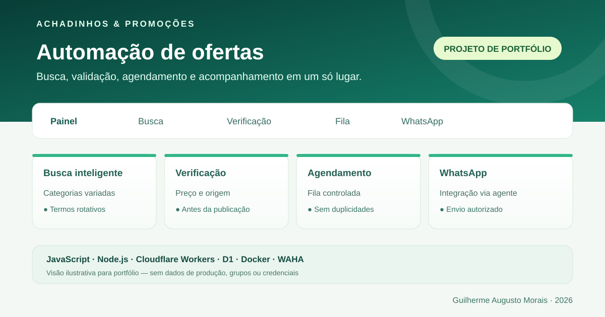
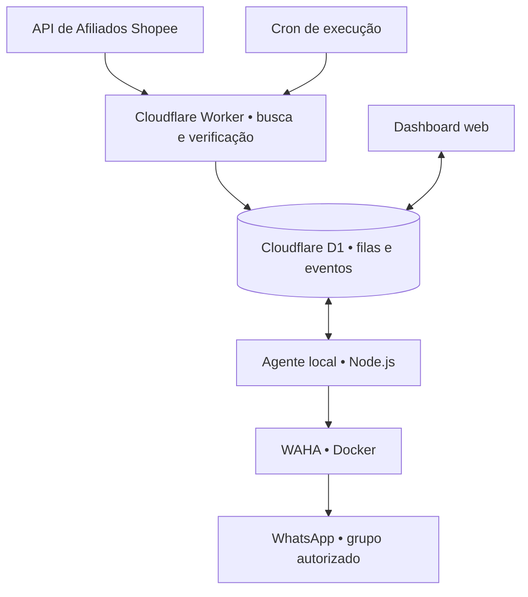

# 🤖 Achadinhos & Promoções — Robô de Ofertas

> **Estudo de caso de um projeto real de automação**, desenvolvido por Guilherme Augusto Morais.
>
> **Esta é a apresentação pública de portfólio.** O código do robô em produção, as credenciais, os identificadores de grupos e as configurações operacionais permanecem em um repositório privado. O código deste diretório não controla os envios.

## 📌 Sobre o projeto

O **Achadinhos & Promoções** nasceu da necessidade de automatizar a descoberta, a avaliação e a organização de ofertas para um canal de promoções no WhatsApp, sem perder o controle sobre a qualidade das informações compartilhadas.

Em vez de copiar ofertas manualmente, o sistema integra fontes de produtos, executa verificações antes de agendar e usa um painel para acompanhar o estado da operação.

O desafio principal foi conectar **serviços em nuvem, banco de dados, APIs de produtos e um agente local de WhatsApp**, considerando limites de uso, prevenção de mensagens duplicadas e segurança.

## ✨ Funcionalidades desenvolvidas

- **Busca programada:** identificação de produtos em diferentes categorias, com paginação e rotação de palavras-chave.
- **Critérios de qualidade:** avaliação, volume de vendas, faixa de preço e desconto mínimo na triagem de ofertas.
- **Revalidação do preço:** conferência antes de preparar ou enviar; alterações impedem a publicação automática.
- **Variedade de produtos:** controle de categorias e prevenção de anúncios muito semelhantes na fila.
- **Filtro de conteúdo:** bloqueio de anúncios eróticos/adultos em múltiplas etapas.
- **Confirmação de origem:** verificação e políticas para anúncios com origem de envio não comprovada.
- **Fila agendada:** janelas de publicação e limites diários para evitar rajadas.
- **Integração com WhatsApp:** envio controlado por agente Windows com WAHA em Docker, restrito a grupo autorizado.
- **Dashboard responsivo:** acompanhamento de fila, verificações, diagnósticos e configurações.
- **Observabilidade e recuperação:** eventos registrados, diagnósticos e acompanhamento de limites do Cloudflare D1.

> **Importante:** uma oferta descoberta não é necessariamente enviada. O envio depende de validações, disponibilidade dos serviços, configuração do agente e autorizações do sistema. O projeto segue em evolução.

## 🧱 Arquitetura em alto nível

**Fluxo resumido:** descobrir → filtrar → verificar → agendar → conferir novamente → entregar ao conector de WhatsApp → registrar resultado.

A análise manual de links do **Mercado Livre** também faz parte do ecossistema Achadinhos, mas **não deve ser confundida com um fluxo de publicação automática completo** para esse marketplace.

## 🛠️ Tecnologias

| Camada | Tecnologias |
| --- | --- |
| Linguagem e backend | JavaScript, Node.js |
| Aplicação em nuvem | Cloudflare Workers, Cron Triggers |
| Banco de dados | Cloudflare D1 (SQLite) |
| Interface | HTML, CSS, JavaScript |
| Produtos | APIs e validação de ofertas da Shopee; análise manual de links do Mercado Livre |
| Integração de mensagens | WAHA, Docker, agente local Windows |
| Desenvolvimento | Git, GitHub, testes automatizados |

## 🧠 Desafios técnicos e aprendizados

### 1. Custo de consultas ao banco

As consultas frequentes de eventos e comandos geraram alto consumo de leituras no **D1 Free**. A correção envolveu análise de consultas, criação de índices, melhoria de filtros por prefixo e acompanhamento do consumo após o deploy.

### 2. Segurança e consistência dos envios

O sistema separa a descoberta da publicação. Os anúncios são submetidos a verificações de preço, link, origem e conteúdo, com estados específicos para resultados incertos. Isso reduz o risco de publicar informações inválidas ou repetir envios.

### 3. Equilíbrio da fila

A lógica de agendamento evoluiu para evitar concentração de uma única categoria. São utilizadas buscas diversificadas, prevenção de títulos semelhantes e regras de frequência, sempre respeitando os limites e as verificações existentes.

### 4. Integração entre nuvem e computador

A infraestrutura em Cloudflare executa buscas e armazena a fila. O envio pelo WhatsApp depende de um agente executado no Windows e do WAHA; por isso, o projeto inclui monitoramento de conectividade e diagnósticos.

## 🔐 Segurança desta versão pública

Esta apresentação **não contém**:

- Tokens, senhas, chaves de API, arquivos `.env` ou credenciais de sessão;
- IDs, convites ou dados pessoais de grupos do WhatsApp;
- Backup do banco, registros de mensagens ou dados de operação;
- Instruções para acessar o painel administrativo de produção.

O diagrama e a imagem são **ilustrações de portfólio**, sem métricas operacionais reais.

## 👨‍💻 Autor

**Guilherme Augusto Morais** — estudante de Análise e Desenvolvimento de Sistemas e Administração, com foco em desenvolvimento de software e automação de processos.

- [Meu perfil no GitHub](https://github.com/Guilherme-code10)
- [Meu LinkedIn](https://www.linkedin.com/in/guilherme-augusto-morais/)

---

**Situação:** projeto real em desenvolvimento e aprimoramento contínuo. Esta página documenta decisões técnicas e aprendizado, não oferece acesso ao sistema privado nem demonstra funcionamento em tempo real.
